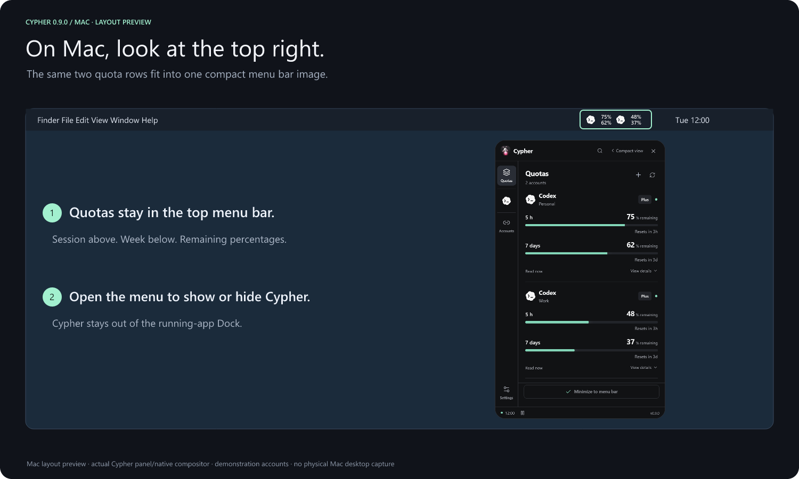

# Cypher for macOS

Cypher is available for **Mac Intel and Apple Silicon**, with a native menu bar indicator at the top right. Working Mac use has been confirmed by the maintainer.

**[Download for Mac Intel](https://github.com/A-Arnaud/Cypher/releases/latest/download/Cypher-0.9.0-mac-x64.dmg)** · **[Download for Apple Silicon](https://github.com/A-Arnaud/Cypher/releases/latest/download/Cypher-0.9.0-mac-arm64.dmg)** · [All Windows and Mac downloads](https://github.com/A-Arnaud/Cypher/releases/latest)

**Requires macOS 13 Ventura or later**, on either processor. This is the minimum declared by the packaged application and its Electron runtime; the automated tests run on macOS 15. macOS 12 Monterey and earlier cannot run this release. On Intel, download the file ending in **`mac-x64.dmg`** or **`mac-x64.zip`**, never `arm64`.

- **Apple Silicon:** choose the `mac-arm64.dmg` or `mac-arm64.zip` download.
- **Intel:** choose `mac-x64.dmg` or `mac-x64.zip`.
- When updating, choose **Quit** in the old Cypher menu first. Open the DMG and replace **Cypher.app** in **Applications**, or extract the ZIP and move the app there, then reopen it. An older process keeps its previous Dock behavior until you quit it.
- Open Cypher and authorize the profiles or API connections you want. The indicator appears automatically **at the top right of the screen**. Its menu opens or hides the widget, refreshes data, pauses collection or quits.
- One compact menu bar image combines provider logos and two percentage rows for up to three pinned accounts: session above, week below. Hover or open the menu for services and actual durations, such as 5h and 7d. A dash means unavailable; balances and model counts remain in the widget. macOS controls available menu bar space, including on displays with a camera notch.
- The default show/hide shortcut remains **Control+Option+Q** (the Mac name for `Control+Alt+Q`).
- Closing the window asks whether to **Minimize to menu bar**, **Quit Cypher** or **Cancel**. Minimizing keeps the app running and its indicator accessible at the top right.

## A discreet menu bar app

Cypher runs as a native Mac agent: its running-app icon stays out of the **Dock** and **Command-Tab**, including after opening its window, Settings or a connection form. Its icon in the **top menu bar** remains the entry point.

[](docs/showcase/macos-location.png)

Layout preview with demonstration readings, using the actual Cypher panel and indicator compositor. [Complete visual guide](docs/screenshots/README.md).

- Click the Cypher icon at the top and choose **Show / Hide** (**Afficher / Masquer**) to open or hide its window.
- **Control+Option+Q** also shows or hides it. Opening Cypher again from Applications restores its window.
- **Quit** (**Quitter**) in the Cypher menu stops the application. Closing the window still offers Minimize, Quit and Cancel.
- **Settings → Quota indicator** can hide or restore quota readings. Your choice survives reopening and login startup. The Cypher menu icon remains accessible.
- If you previously pinned Cypher to the Dock, use that icon's **Options → Remove from Dock** once. A manually pinned favorite belongs to macOS and is separate from Cypher's running-app icon.

This is the Mac behavior documented by Apple for [menu bar apps](https://developer.apple.com/documentation/swiftui/menubarextra) and [agent applications](https://developer.apple.com/documentation/bundleresources/information-property-list/lsuielement). Cypher declares `LSUIElement=true` in its packaged app and keeps the accessory activation policy while its window is open. It does not change your Dock preferences or other applications.

## First launch

The app works on Mac, but this download is **not notarized by Apple**. If macOS blocks the first launch, verify the download's SHA-256 and use **System Settings → Privacy & Security → Open Anyway** for Cypher. This is a signing prompt, separate from Mac compatibility. [First-launch help](docs/downloads.md#first-launch).

If you want Cypher to open at login, first move it into **Applications**, then enable **Settings → Open at login** in Cypher. It starts directly in the **top menu bar**, without showing its window. macOS may require approval in **System Settings → General → Login Items**; Cypher displays a separate pending-approval status when appropriate and verifies registration rather than silently assuming success. You can disable the switch at any time. Placing Cypher in the menu bar alone does not enable login startup. Signing/notarization still affects login-item reliability; a rejected registration is shown as an error. [Electron login-item behavior](https://www.electronjs.org/docs/latest/api/app#appsetloginitemsettingssettings).

API keys use Electron safeStorage backed by the macOS Keychain. Windows credentials cannot be copied over and decrypted on a Mac.

## Connection methods

Connections keeps **Automatic detection** first. Expand **Other ways to connect** for browser sign-in, an installed CLI, profile-folder import or the supported API-key alternative. See [connection methods and provider limits](docs/connection-methods.md).

**Codex browser sign-in** uses an official component included in Cypher: no separate Codex CLI, Codex app or Node installation is required. A new browser connection creates its own Cypher profile and does not replace an existing account. Claude and Gemini currently retain their CLI sign-in methods.

### Existing CLI connections

Cypher discovers executable CLI commands on `PATH`, in `~/.local/bin`, `/opt/homebrew/bin`, `/usr/local/bin` and `~/.npm-global/bin`. Use **Already installed?** to choose a CLI manually if your Node version manager puts it elsewhere. Node-based launchers need Node available alongside the launcher or on `PATH`.

Sign-in opens a separate **Terminal** instance using the official CLI and the selected profile only. Return to Cypher and refresh after completing sign-in. Existing provider limitations still apply: Claude and Gemini detection/sign-in do not imply implemented subscription quotas. See the [provider matrix](README.md#what-works-today).

## Verification and builds

Working use on an **Intel Mac has been confirmed by the maintainer**. GitHub Actions also builds and tests separately on **macOS 15 Apple Silicon and Intel**, including unit/subprocess tests, native menu bar docking/restore, final app/connector launch and signature checks, and publication scans. See [verification records](VERIFICATION.md) for exact evidence and advanced display/provider cases; these checks do not constitute Apple notarization.

Maintainers preparing a future Apple-signed build should follow [Developer ID signing and notarization](docs/macos-signing.md).

```sh
npm ci
npm run dev
npm run typecheck
npm run test:mac
npm run dist:mac
```

Build on macOS using Node.js 24. Local `dist:mac` builds for the host architecture; GitHub's separate Intel and Apple Silicon runners build each target with its matching Codex component. Cross-architecture packaging is rejected rather than silently shipping the wrong executable. The Windows C# taskbar helper is built only on Windows; it is never launched by the Mac backend. Windows retains its existing taskbar/notification-area behavior.

References: [Apple menu bar](https://support.apple.com/en-gb/guide/mac-help/mchlp1446/mac), [Electron Tray](https://www.electronjs.org/docs/latest/api/tray), [Electron login items](https://www.electronjs.org/docs/latest/api/app#appsetloginitemsettingssettings).
