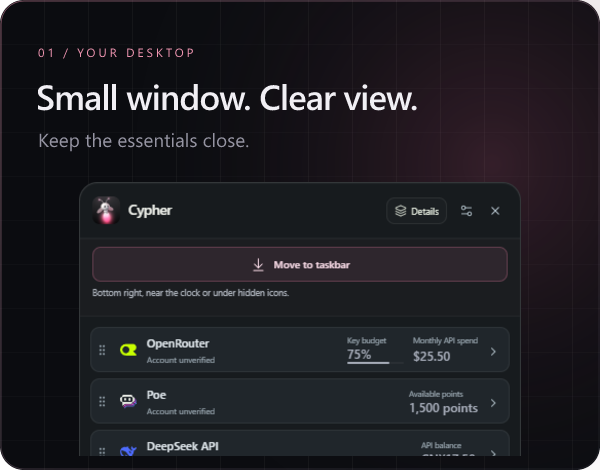
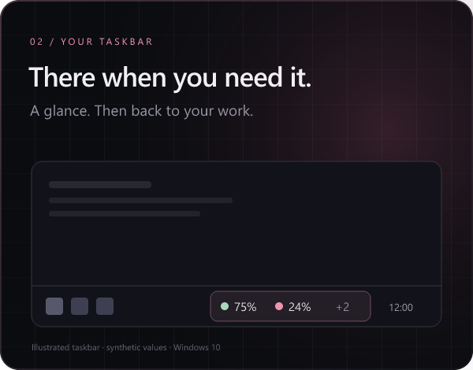
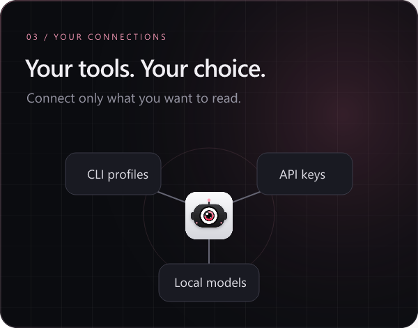

<div align="center">
  
  <p><strong>Your AI usage, always in view.</strong><br>
  Monitor provider-reported quotas, API balances and local model availability<br>
  from a compact Windows widget or your taskbar.</p>
  <p><strong><a href="https://github.com/A-Arnaud/Cypher/releases/latest">Download Cypher for Windows</a></strong></p>
  <p><a href="https://github.com/A-Arnaud/Cypher/releases/download/v0.4.9/Cypher-Setup-0.4.9-win-x64.exe">Installer · 0.4.9</a> · <a href="https://github.com/A-Arnaud/Cypher/releases/download/v0.4.9/Cypher-0.4.9-win-x64.exe">Portable</a> · <a href="https://github.com/A-Arnaud/Cypher/releases/download/v0.4.9/SHA256SUMS-0.4.9.txt">SHA-256</a></p>
  <p>
    <a href="https://github.com/A-Arnaud/Cypher/releases/latest"></a>
    
    <a href="PRIVACY.md"></a>
    <a href="https://github.com/A-Arnaud/Cypher/actions/workflows/security.yml"></a>
  </p>
  <p><a href="https://cypher-os.me/">Website</a> &middot; <a href="#get-started">Get started</a> · <a href="#what-works-today">Provider status</a> · <a href="#screenshots">Screenshots</a> · <a href="SECURITY.md">Security</a> · <a href="PRIVACY.md">Privacy</a> · <a href="SUPPORT.md">Support</a> · <a href="CONTRIBUTING.md">Contribute</a> · <a href="https://github.com/A-Arnaud/Cypher/issues">Issues</a></p>
</div>

Windows 10 x64 is the verified native target. See the [launch checklist](docs/launch-checklist.md) for release, discovery and first-user feedback guidance.

<a href="https://github.com/A-Arnaud/Cypher/releases/latest"></a>

## Why Cypher

- **Keep usage beside your work.** Switch between compact rows, detailed cards and a native taskbar indicator.
- **Read only what you authorize.** Grant access per CLI profile or enter a supported API key explicitly. No telemetry or browser-cookie collection.
- **See the limits of the data.** Missing and stale readings are marked. API spending, balances and subscription quotas keep their own meaning.

## Choose your path

**Try it:** [Windows setup](#get-started) · **Check compatibility:** [provider status](#what-works-today) · **Need help:** [FAQ](SUPPORT.md#faq) or [report an issue](https://github.com/A-Arnaud/Cypher/issues/new/choose) · **Build with us:** [contributor guide](CONTRIBUTING.md).

<table>
  <tr>
    <td width="33%" align="center"><a href="#desktop-widget"></a></td>
    <td width="33%" align="center"><a href="#windows-taskbar"></a></td>
    <td width="33%" align="center"><a href="#connections"></a></td>
  </tr>
</table>

- **Desktop widget:** pin your profiles, reorder them, and switch between compact rows and detailed cards.
- **Windows taskbar:** keep a small quota indicator visible and click it to open the full window.
- **Connections:** grant read access to individual CLI profiles, add a supported API key, or check a local model server.

---

## Get started

1. Open the [latest release](https://github.com/A-Arnaud/Cypher/releases/latest).
2. Download **`Cypher-Setup-0.4.9-win-x64.exe`** for installation and Windows startup, or **`Cypher-0.4.9-win-x64.exe`** for portable use.
3. Open **Connections** and choose a supported provider. Existing CLI profiles require your permission before account reads; API connections require a key you enter explicitly.
4. Pin your profiles. Use **Widget** for compact rows or **Put in taskbar** for the Windows indicator.

**Requirements:** Windows 10 x64. End users do not need Node.js. CLI connections need the relevant official CLI; API and local-server connections do not. Fresh installs open in English; French remains available in Settings.

The executables are **not Authenticode-signed**, so Windows may display a warning. Check the release's SHA-256 file before running a download. No administrator rights are required. The portable app extracts Electron at launch and does not support automatic Windows startup.

## Desktop widget

Keep only the profiles you need in a compact, draggable window. Reorder by dragging a handle or using the keyboard. Open **Details** for quota windows, balances, points and reset times when the provider exposes them.

Change opacity, always-on-top behavior, the keyboard shortcut and refresh interval in Settings. The default interval is **60 seconds after a collection completes**; errors use exponential backoff up to 15 minutes. Pause suspends collection. Refresh starts a new read immediately.

**Ctrl+Alt+Q** shows or hides Cypher. Closing or hiding the window keeps collection running; **Quit** stops the application.

## Windows taskbar

Use **Put in taskbar** to reserve a small area next to your existing taskbar content. It shows up to three pinned profiles and a `+N` count. Click the indicator to open the full window.

The installed or extracted app can launch with Windows. Startup is independently configurable in Settings. Leaving taskbar mode keeps your startup preference.

**Verified target:** Windows 10 x64 with a horizontal primary taskbar. Windows 11, vertical or secondary taskbars and untested DPI configurations are not certified. See [verification notes](VERIFICATION.md) for the actual test scope.

## Connections

CLI profiles stay independent. Cypher does not overwrite another account to add a new one. Shared quotas are flagged only when a reliable provider identity confirms the same account.

Unknown data stays unknown. A dash is unavailable data, never a fabricated zero. Stale values are marked, subscription quotas are not added together, and API billing remains separate from chat subscriptions.

### What works today

| Status | Connection | Available today / boundary |
| --- | --- | --- |
| Implemented | **Codex** | Account and provider quota windows through an authorized, signed-in CLI profile; fields depend on the provider |
| Partial | **Claude Code** | CLI login and account status; subscription quotas are not implemented |
| Partial | **Gemini CLI** | Detection and profile sign-in flow; account plan and quota reads are not implemented |
| Implemented | **OpenRouter, DeepSeek, Poe** | Key budget/monthly spending, available API balance or points respectively; provider-specific units and permissions |
| Implemented | **fal.ai** | Available credit balance/currency with billing usage read permission; not a chat subscription quota |
| Implemented | **OpenAI, Anthropic, Together AI APIs** | Organization spending; key permissions vary and Together excludes the current day. Not a remaining quota or guaranteed prepaid balance |
| Implemented | **Ollama, LM Studio, llama.cpp, vLLM** | Model lists from fixed loopback endpoints after authorization; no cloud quota |
| Discovery only | **Cursor, Windsurf, Copilot, OpenCode, Aider, Continue** | Installation/configuration discovery or upstream billing guidance; no account/quota connector |
| Planned | **ChatGPT, Perplexity and other planned catalog entries** | Provider links only; no implemented account/quota read |

**Implemented** means connector code exists, not universal live-account validation. API collectors have synthetic-response test coverage; real-account validation remains outstanding. **Partial**, **discovery only** and **planned** do not imply quota support. See the [full coverage matrix](docs/catalog-coverage.md), [verification evidence](VERIFICATION.md) and [privacy policy](PRIVACY.md).

## Screenshots

<details>
<summary><strong>See the interface</strong></summary>

<p align="center">
  
  
</p>

Screenshots use account-free previews and synthetic values. They do not display a developer's account or prove live provider availability.

</details>

---

## Privacy and security

- No telemetry, browser-cookie collection or AI messages.
- CLI account reads require permission for the selected profile.
- API keys entered in Connections are encrypted locally with Windows DPAPI and removable in the app.
- The renderer is sandboxed with context isolation, validated IPC and a restrictive production content security policy.
- Profiles, keys, preferences, diagnostics and build outputs are excluded from Git. Publication checks scan sources, Git history and the packaged archive.

DPAPI does not protect against malicious software running as your Windows user. Provider requests still reach the selected provider. These safeguards and scans are not an independent security certification. Read [Security](SECURITY.md) and [Privacy](PRIVACY.md) before connecting an account.

## Development

Use **Node.js 24** and npm on Windows. The native taskbar helper also uses the Windows .NET Framework 4.x C# compiler. Browser tests use Microsoft Edge.

```powershell
npm ci
npm run dev
```

```powershell
npm run typecheck
npm test
npm run test:ui
npm run security:scan
npm run security:secrets
npm run dist
npm run security:release
```

`npm run build:test` creates a separate test package for isolated Electron checks, never a release artifact. Production executables disable the inspection facilities used by these tests. See [Contributing](CONTRIBUTING.md), [implementation notes](docs/IMPLEMENTATION-NOTES.md) and [verification](VERIFICATION.md).

## Help improve Cypher

[Report a bug, suggest a feature or request a provider](https://github.com/A-Arnaud/Cypher/issues/new/choose). Small documentation improvements, reproducible Windows reports and synthetic provider fixtures are useful starting points; see [Contributing](CONTRIBUTING.md) before changing code. Read [Security](SECURITY.md#reporting-a-vulnerability) for vulnerability reports instead of opening a normal issue.

No API keys, CLI credentials, cookies or private account data belong in an issue, pull request, log or screenshot. See the [changelog](CHANGELOG.md) for shipped changes and the [launch checklist](docs/launch-checklist.md) for release and discovery preparation.
