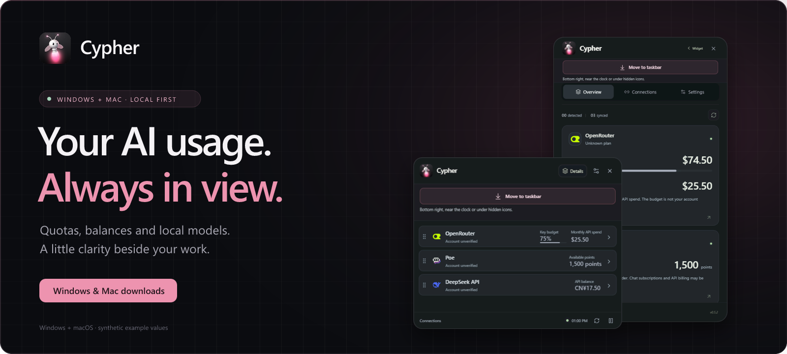
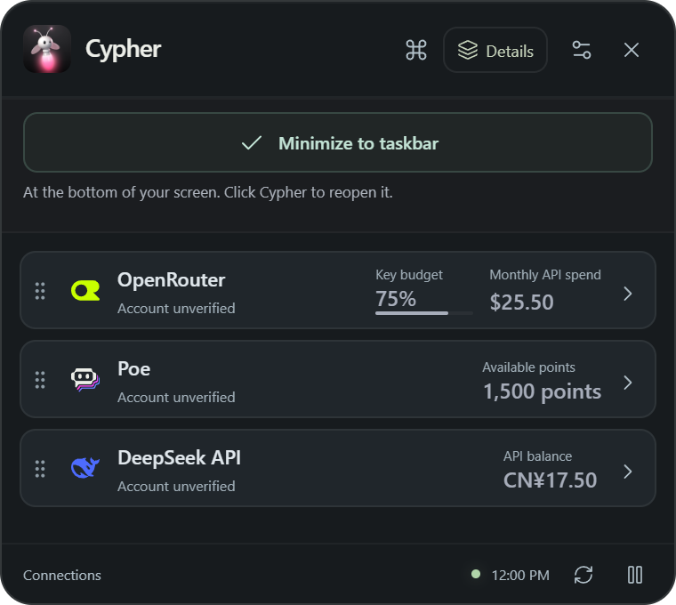
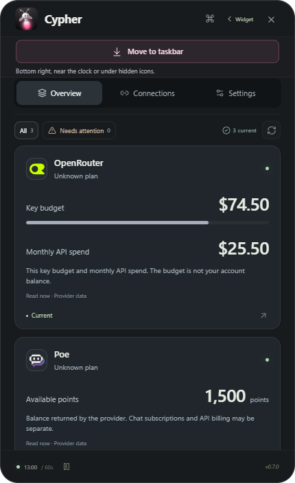

<div align="center">
  
  <p><strong>Your AI usage, always in view.</strong><br>AI quotas, API balances and local models — on Windows and Mac.</p>
  <p>
    <a href="https://github.com/A-Arnaud/Cypher/releases/latest/download/Cypher-Setup-0.5.0-win-x64.exe"></a>
    <a href="https://github.com/A-Arnaud/Cypher/releases/latest/download/Cypher-0.5.1-mac.2-mac-x64.dmg"></a>
    <a href="https://github.com/A-Arnaud/Cypher/releases/latest/download/Cypher-0.5.1-mac.2-mac-arm64.dmg"></a>
  </p>
  <p><a href="#download">Downloads</a> · <a href="#get-started">Quick start</a> · <a href="#what-works-today">Supported services</a> · <a href="SUPPORT.md">Help</a></p>
</div>

## Download

**Choose your computer. The links below download the app directly.**

| Your computer | Download | Requirements |
| --- | --- | --- |
| **Windows 10 or Windows 11** | **[Download for Windows](https://github.com/A-Arnaud/Cypher/releases/latest/download/Cypher-Setup-0.5.0-win-x64.exe)** | Windows x64 · same installer for both versions |
| **Mac with an Intel processor** | **[Download for Mac Intel](https://github.com/A-Arnaud/Cypher/releases/latest/download/Cypher-0.5.1-mac.2-mac-x64.dmg)** | macOS 13 Ventura or later |
| **Mac with an Apple chip (M1, M2, M3…)** | **[Download for Mac Apple Silicon](https://github.com/A-Arnaud/Cypher/releases/latest/download/Cypher-0.5.1-mac.2-mac-arm64.dmg)** | macOS 13 Ventura or later |

**Which Mac do I have?** Open **Apple menu → About This Mac**. If it says **Intel**, choose Mac Intel. If it says **Chip: Apple M…**, choose Apple Silicon.

[Portable Windows, Mac ZIP and checksums](docs/downloads.md#other-downloads) · [All downloads and release notes](https://github.com/A-Arnaud/Cypher/releases/latest)

## Get started

1. **Install.** On Windows, run the installer. On Mac, open the DMG and drag **Cypher.app** into **Applications**.
2. **Connect.** Open **Connections**. Cypher detects existing profiles first; authorize the ones you want to read. On Mac, **More ways to connect** also offers Codex browser sign-in without installing a CLI, plus CLI and API-key alternatives.
3. **Keep it visible.** Pin your accounts, choose the desktop widget, or enable the Windows indicator / Mac menu bar.

You do not need Node.js to run Cypher. English and French are available in Settings.

**First-launch security prompts:** Windows may show a SmartScreen warning; Mac may require **Privacy & Security → Open Anyway**. These builds are not publisher-signed/notarized. [Installation help](docs/downloads.md#first-launch).

<a href="#download"></a>

## Why Cypher

- **See usage beside your work.** Compact widget, detailed cards and a system indicator.
- **Choose what to connect.** Independent profiles, explicit read permission and supported API-key connections.
- **Keep data local.** No telemetry, browser-cookie collection or AI messages. Missing readings stay unknown; API billing stays separate from subscriptions.

<a id="desktop-widget"></a>
<a id="windows-taskbar"></a>
<a id="windows-compatibility"></a>

## Windows and Mac

| Platform | Where Cypher appears |
| --- | --- |
| **Windows 10** | Desktop widget + embedded indicator on the primary horizontal taskbar |
| **Windows 11** | Desktop widget + notification-area icon, tooltip and menu; the icon may be under hidden icons |
| **macOS** | Desktop widget + native menu bar indicator **at the top right**, on Intel and Apple Silicon |

**Mac works:** Intel use has been confirmed by the maintainer, and Intel / Apple Silicon builds pass automated checks. See the [Mac guide](MACOS.md) for setup and [verification record](VERIFICATION.md) for tested environments.

Closing the window keeps collection running. **Quit** stops Cypher. The default show/hide shortcut is **Ctrl+Alt+Q** on Windows and **Control+Option+Q** on Mac. [Widget and indicator guide](docs/user-guide.md).

## Connections

Existing profiles come first. Additional methods depend on the provider and downloaded version: [connection options](docs/connection-methods.md).

### What works today

| Connection | What Cypher can show |
| --- | --- |
| **Codex** | Account and provider-reported quota windows; Mac also includes browser sign-in without a separate CLI |
| **Claude Code / Gemini CLI** | CLI detection and sign-in; Claude account status. Subscription quota reads are not implemented |
| **OpenRouter, DeepSeek, Poe, fal.ai** | Supported key budgets, API balances or points |
| **OpenAI, Anthropic, Together AI APIs** | Organization spending, with provider-specific key permissions; separate from chat subscriptions |
| **Ollama, LM Studio, llama.cpp, vLLM** | Local model availability after authorization |
| **Other catalog entries** | Some offer discovery or provider links only; a listed service does not imply a working quota connector |

[Full provider coverage](docs/catalog-coverage.md) · [Privacy](PRIVACY.md) · [Security](SECURITY.md)

## Screenshots

<details>
<summary>Compact widget and detailed cards</summary>

<p align="center">
  
  
</p>

Screenshots use synthetic data, not a developer's account.

</details>

## Development

Use **Node.js 24** and npm. [Contributing](CONTRIBUTING.md) covers Windows setup; the [Mac guide](MACOS.md#verification-and-builds) covers macOS.

```sh
npm ci
npm run dev
```

[Windows checks](https://github.com/A-Arnaud/Cypher/actions/workflows/security.yml) · [Mac checks](https://github.com/A-Arnaud/Cypher/actions/workflows/macos.yml) · [Changelog](CHANGELOG.md)

## Help and feedback

[Installation help](docs/downloads.md) · [FAQ](SUPPORT.md#faq) · [Report a bug or request a provider](https://github.com/A-Arnaud/Cypher/issues/new/choose) · [Website](https://cypher-os.me/)

Never attach API keys, login codes, CLI credentials, cookies or private account data to an issue. Report vulnerabilities through [Security](SECURITY.md#reporting-a-vulnerability).
