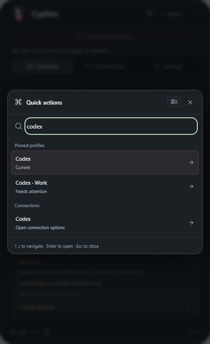
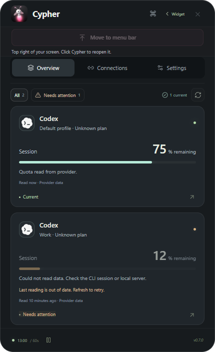

# Find a profile and understand its status

## Quick actions

Click the **Quick actions** button beside the window controls, or press **Ctrl+K** on Windows / **Command+K** on Mac while Cypher is focused. This works in both the detailed and compact widget views; it is separate from the configurable global show/hide shortcut.

Search actions, pinned profile names or provider connections. Search ignores accents, so `reglages` also finds the French settings action. **Up/Down** selects a result, **Enter** opens it, and **Escape** closes the picker and restores focus. Mouse selection is also available. Unsupported actions stay disabled rather than silently doing nothing.

Actions include navigation, compact view, refresh, pause/resume, moving into the system bar, update checks and diagnostics. Choosing a pinned profile opens its detailed card; choosing a service opens its connection options. Searching never starts a login, reads a profile or exports anything by itself.

## Read status before trusting a number

The **All / Needs attention** filter covers pinned profiles. The current-reading count excludes failed, old, paused, duplicate and unsupported readings. Detailed cards explain a problem and show the age/source of their last successful metrics; compact rows carry a short status label when necessary.

| Status | Meaning |
| --- | --- |
| Current | A successful metric reading within the freshness window |
| Needs attention | Sign-in/permission required, failed reading, stale data or a provider percentage below your selected alert threshold |
| Waiting | Authorized or connected, but no successful metric reading yet |
| Limited support | Discovery/account status exists, but this connector does not supply quota data |
| Paused | Collection is paused; retained values are not presented as current |
| Duplicate | Another profile already represents this confirmed account |

Readings become old after the greater of **three refresh intervals or three minutes**, even when no new provider event arrives. An explicitly failed/stale read is marked immediately. Failed reads never make an old metric look new. A displayed zero remains a real value; unavailable data remains unknown. Only provider-reported percentages use the chosen quota-alert thresholds; API balances/model counts do not become fake percentage alerts.

These statuses describe quota collection. They do not claim that a coding agent is working, blocked or finished, and installation alone does not establish a paid plan. Existing [provider limits](catalog-coverage.md) remain.

## A private, versioned diagnostic report

Open **Settings → Diagnostics** or find **Diagnostics** in Quick actions. **View report** prepares local JSON. **Copy report** prepares a fresh report and writes it to the system clipboard after that click. No report is generated/exported merely by opening the section. Nothing is uploaded or saved automatically.

The `cypher.diagnostics/v1` format contains app/OS/architecture, collection settings and counts, indicator/startup/update status, known connector IDs and anonymous per-profile health reasons/ages. It excludes profile/account names, emails, paths, keys, quota amounts, raw provider errors and logs. Review it before choosing to share it in a support request; the clipboard can be read by other applications or clipboard managers.

Both detailed UI and reports use the same health model. Native report handlers verify the trusted main-window sender. The renderer cannot select a file/path to read or provide arbitrary clipboard content. This feature does not open a socket, add a CLI service or grant another process access to accounts.
